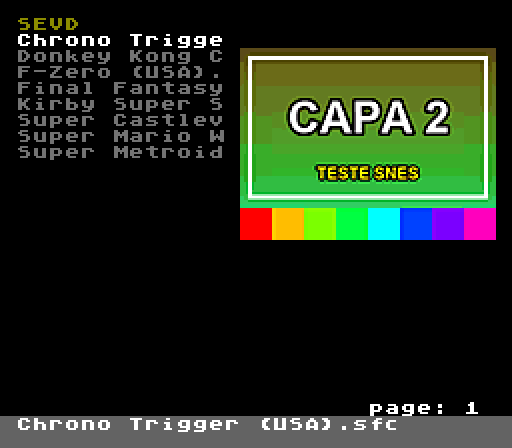
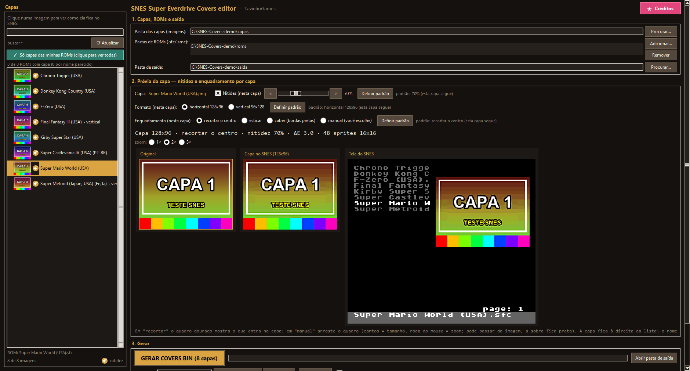
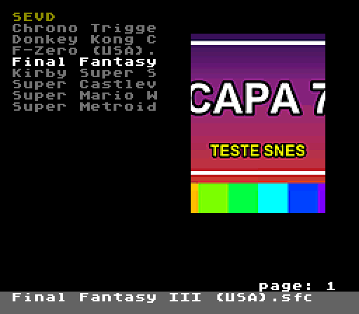
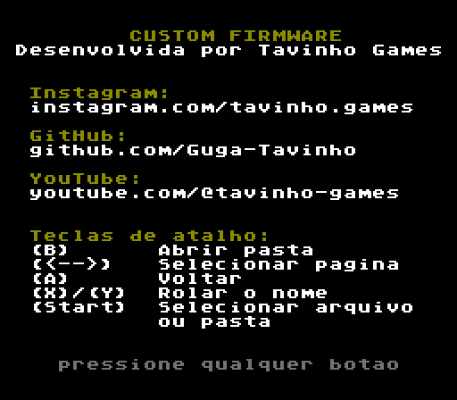

# SNES Super Everdrive Covers editor

**🇧🇷 [Português](README.md) · 🇺🇸 [English](README.en.md) · 🇪🇸 [Español](README.es.md)**

---

## 🇺🇸 English

Custom firmware for the **SNES Super EverDrive (clone)** that shows **each game's cover art** next to the game
list, plus a Windows tool that converts your images and prepares everything for the SD card.

### What's new compared to the original firmware

| | Original | Custom |
|---|---|---|
| **Cover art** | — | Cover on the right of the list, up to **120 colors**, no flicker |
| **Cover format** | — | **Horizontal 128×96** or **vertical 96×128**, chosen **per game** |
| **Name in the list** | `001 Secret of Ma` + size/`DIR` | Game name only (13 characters), no row number |
| **Full name** | Only by scrolling with X/Y | **Gray bar** at the bottom with the full name (up to 60 characters) |
| **Page number** | Bottom left | **Bottom right** |
| **← →** (change page) | Keeps the cursor row | Jumps to the **first game of the page** |
| **About screen** | Manufacturer credits | Custom firmware credits + **shortcut keys** |

 

Everything else works like the original firmware: loading games, saves (SRAM), options, OS update, etc.

### Requirements

- **Windows 10 or 11 (64-bit)** for the tool. Nothing to install (no Python needed).
- An **SNES Super EverDrive clone**. The firmware is based on this cartridge's **OS v12**.
- Cover images (**PNG, JPG, BMP, GIF or WEBP**).

### Installing the tool

1. Download **`SNES Super Everdrive Covers Editor.zip`** from the *Releases* page.
2. **Extract** the zip to a folder (do not run the program from inside the zip).
3. Open **`SNES Super Everdrive Covers Editor.exe`**. Always keep the **`_internal`** folder next to the `.exe`.

> Windows may show "Windows protected your PC" (new program without a digital signature). Click
> **More info → Run anyway**.

### How to use

> The tool's interface is in **Portuguese**. Below, the screen labels are shown exactly as they appear,
> with the translation in parentheses.

**1. Capas, ROMs e saída** (covers, ROMs and output)
- **Pasta das capas** (covers folder): the folder with your images. The image name should be similar to the ROM name
  (e.g. `Super Metroid (Japan, USA).png`). The tool matches them automatically even with small differences
  (region, version, `(Rev 1)`, `[!]`…).
- **Pastas de ROMs** (ROM folders): where your ROMs are (`.sfc`, `.smc`, `.fig`, `.swc`). It can be the SD card itself;
  subfolders are included.
- **Pasta de saída** (output folder): where the files are generated.

In the left list, **"Mostrar só capas das minhas ROMs"** (show only covers of my ROMs) shows only the images
that will be used, and **"Ver ROMs sem capa…"** (see ROMs without cover) lists the ROMs that didn't find an image.

**2. Prévia da capa** (cover preview) — click a cover in the list to see how it looks on the SNES.

| Option | What it does |
|---|---|
| **Formato** (format) | Horizontal 128×96 (US boxes) or vertical 96×128 (Japanese/European boxes). |
| **Nitidez** (sharpness, 10–200%) | Enhances edges and text when shrinking the image. |
| **Enquadramento** (framing) | **recortar o centro** (crop center), **esticar** (stretch), **caber** (fit, black borders) or **manual**. |
| **Manual** | Drag the golden frame on the original image: corners resize it, the mouse wheel zooms in/out. The frame may go past the image (the extra area becomes black). |
| **Definir padrão** (set default) | Applies the choice to every cover without its own setting. |
| **Previews** | Original, the cover as the SNES shows it, and the **console screen** (same as on the TV). |

Each cover's settings are saved in `capas_config_snes.json`, inside the covers folder.

**3. Gerar** (generate)
1. Under **Cartão SD** (SD card), click **Adicionar caminho…** (add path) and choose the root of the card (e.g. `F:\`).
2. Keep **"copiar também a firmware para o cartão"** (also copy the firmware to the card) checked (the first time).
3. Click **GERAR COVERS.BIN** (generate). This goes to the card:
   - `SEVD\COVERS.BIN` (the covers)
   - `os-capas-v4.smc` (the firmware, at the root of the card)

**4. Install the firmware on the console (only once)**
1. Turn on the console and go to **toolbox → update os**.
2. Choose **`os-capas-v4.smc`**, press **Start** and confirm with **B (YES)**.
3. Wait until it finishes (step1, step2, step3); the console restarts by itself.

After that, to change or add covers, just **generate again** — there's no need to reinstall the firmware.

### Buttons in the file browser

| Button | Action |
|---|---|
| **B** | Open folder |
| **← →** | Previous / next page (jumps to the top of the page) |
| **A** | Back |
| **X / Y** | Scroll a long name in the list |
| **Start** | Select file / folder |

### Limitations

- **Up to 4,000 covers** per card (**3,851** if any cover is vertical).
- **Up to 200 items per folder** (limit of the cartridge's original OS).
- **No accented letters:** the console font has none; they are shown as spaces.
- **List order:** the original OS sorts by the **first 2 letters** only; games starting the same way
  (e.g. several "Super …") may be out of order among themselves.
- The list shows **13 characters** of the name; the bar shows up to **60 characters**.
- The cover is found by the **ROM file name**. If you rename a ROM, generate `COVERS.BIN` again.
  ROMs with the same name in different folders share the same cover.
- Made and tested for the **Super EverDrive clone with OS v12**. Other versions/models were not tested.

### Safety

- The firmware is installed with the console's **original "update os"** and only writes the main OS area.
  The **reserve OS** (recovery system) is **never changed**.
- **If something goes wrong:** turn on the console **holding X + A** to enter the *reserve OS* and reinstall
  the original firmware (`os-v12.smc`) through **toolbox → update os**.
- Keep a copy of your cartridge's original firmware.

### Credits

- Custom firmware and tool: **Tavinho Games** —
  [Instagram](https://www.instagram.com/tavinho.games) ·
  [GitHub](https://github.com/Guga-Tavinho) ·
  [YouTube](https://www.youtube.com/@tavinho-games)
- Original Super EverDrive OS: **Krikzz** (I. Golubovskiy).

---

