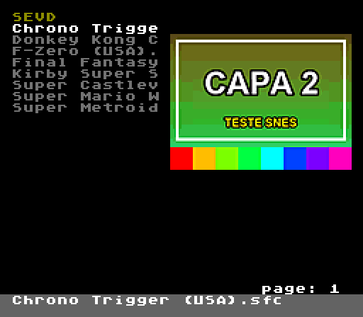
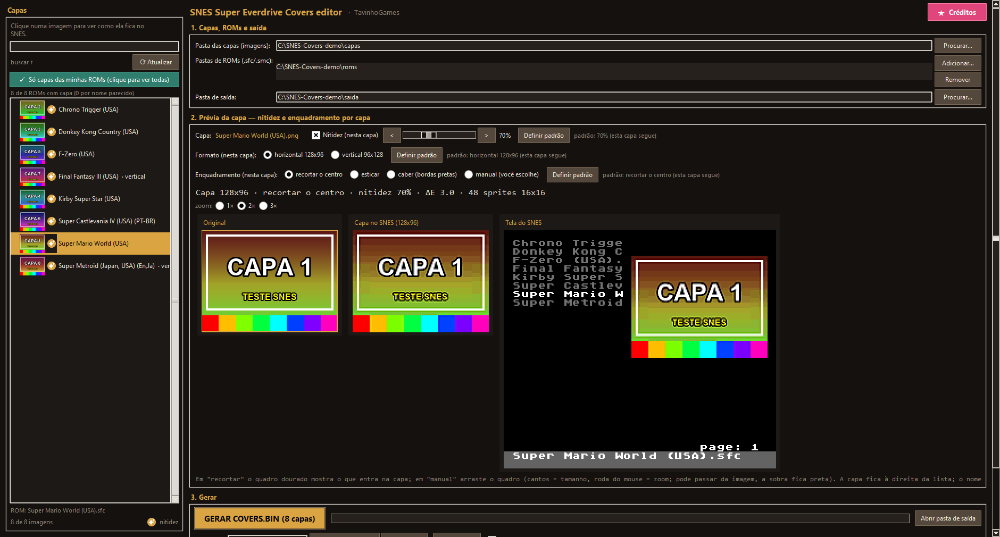
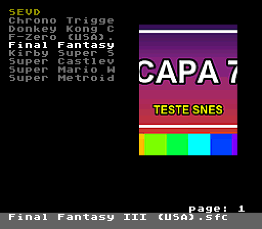
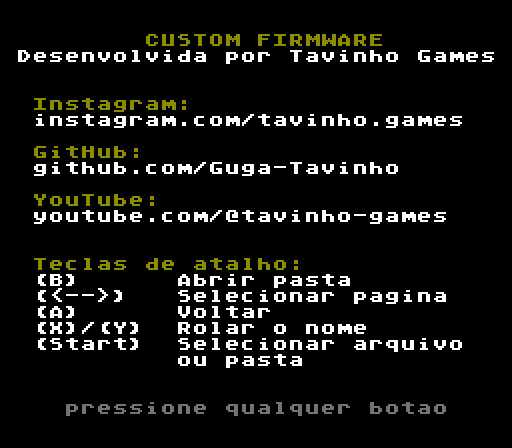

# SNES Super Everdrive Covers editor

**🇧🇷 [Português](README.md) · 🇺🇸 [English](README.en.md) · 🇪🇸 [Español](README.es.md)**

---

## 🇪🇸 Español

Firmware custom para el **Super EverDrive (clon) de SNES** que muestra la **carátula de cada juego** junto a la
lista de juegos, y una herramienta para Windows que convierte tus imágenes y deja todo listo para la tarjeta SD.

### Novedades respecto a la firmware original

| | Original | Custom |
|---|---|---|
| **Carátula** | — | Carátula a la derecha de la lista, hasta **120 colores** y sin parpadeo |
| **Formato de la carátula** | — | **Horizontal 128×96** o **vertical 96×128**, elegido **por juego** |
| **Nombre en la lista** | `001 Secret of Ma` + tamaño/`DIR` | Solo el nombre del juego (13 letras), sin número delante |
| **Nombre completo** | Solo desplazando con X/Y | **Barra gris** abajo con el nombre completo (hasta 60 letras) |
| **Número de página** | Abajo a la izquierda | En la **esquina derecha** |
| **← →** (cambiar página) | Mantiene la línea del cursor | Va al **primer juego de la página** |
| **Pantalla "about"** | Créditos del fabricante | Créditos de la custom + **teclas de acceso rápido** |

 

El resto de la consola funciona como en la firmware original: cargar juegos, partidas guardadas (SRAM), opciones,
actualización del OS, etc.

### Requisitos

- **Windows 10 u 11 (64 bits)** para la herramienta. No hay que instalar nada (ni Python).
- Un **Super EverDrive clon de SNES**. La firmware está hecha a partir del **OS v12** de este cartucho.
- Las imágenes de las carátulas (**PNG, JPG, BMP, GIF o WEBP**).

### Instalación de la herramienta

1. Descarga **`SNES Super Everdrive Covers Editor.zip`** desde la página de *Releases*.
2. **Extrae** el zip en una carpeta (no ejecutes el programa desde dentro del zip).
3. Abre **`SNES Super Everdrive Covers Editor.exe`**. Deja siempre la carpeta **`_internal`** junto al `.exe`.

> Windows puede mostrar "Windows protegió su PC" (programa nuevo, sin firma digital). Haz clic en
> **Más información → Ejecutar de todas formas**.

### Cómo usar

> La interfaz de la herramienta está en **portugués**. Abajo, los textos de la pantalla aparecen tal cual,
> con la traducción entre paréntesis.

**1. Capas, ROMs e saída** (carátulas, ROMs y salida)
- **Pasta das capas** (carpeta de carátulas): la carpeta con las imágenes. El nombre de la imagen debe parecerse al de la ROM
  (ej.: `Super Metroid (Japan, USA).png`). La herramienta las asocia sola aunque haya pequeñas diferencias
  (región, versión, `(Rev 1)`, `[!]`…).
- **Pastas de ROMs** (carpetas de ROMs): donde están tus ROMs (`.sfc`, `.smc`, `.fig`, `.swc`). Puede ser la propia tarjeta SD;
  también se leen las subcarpetas.
- **Pasta de saída** (carpeta de salida): donde se generan los archivos.

En la lista de la izquierda, **"Mostrar só capas das minhas ROMs"** (mostrar solo carátulas de mis ROMs) muestra
solo las imágenes que se usarán, y **"Ver ROMs sem capa…"** (ver ROMs sin carátula) lista las ROMs que no
encontraron imagen.

**2. Prévia da capa** (vista previa) — haz clic en una carátula de la lista para ver cómo queda en la SNES.

| Opción | Qué hace |
|---|---|
| **Formato** | Horizontal 128×96 (cajas americanas) o vertical 96×128 (cajas japonesas/europeas). |
| **Nitidez** (10–200%) | Realza bordes y letras al reducir la imagen. |
| **Enquadramento** (encuadre) | **recortar o centro** (recortar el centro), **esticar** (estirar), **caber** (ajustar, con bordes negros) o **manual**. |
| **Manual** | Arrastra el marco dorado sobre la imagen original: por las esquinas cambia el tamaño, la rueda del ratón acerca/aleja. El marco puede salir de la imagen (lo que sobra queda negro). |
| **Definir padrão** (definir por defecto) | Aplica la elección a todas las carátulas sin ajuste propio. |
| **Vistas previas** | Original, la carátula como la muestra la SNES y la **pantalla de la consola** (igual que en la TV). |

Los ajustes de cada carátula se guardan en `capas_config_snes.json`, dentro de la carpeta de carátulas.

**3. Gerar** (generar)
1. En **Cartão SD** (tarjeta SD), haz clic en **Adicionar caminho…** (añadir ruta) y elige la raíz de la tarjeta (ej.: `F:\`).
2. Deja marcado **"copiar também a firmware para o cartão"** (copiar también la firmware a la tarjeta) (la primera vez).
3. Haz clic en **GERAR COVERS.BIN** (generar). Se copia a la tarjeta:
   - `SEVD\COVERS.BIN` (las carátulas)
   - `os-capas-v4.smc` (la firmware, en la raíz de la tarjeta)

**4. Instalar la firmware en la consola (solo una vez)**
1. Enciende la consola y ve a **toolbox → update os**.
2. Elige **`os-capas-v4.smc`**, pulsa **Start** y confirma con **B (YES)**.
3. Espera a que termine (step1, step2, step3); la consola se reinicia sola.

Después, para cambiar o añadir carátulas, solo hay que **generar de nuevo** — no hace falta reinstalar la
firmware.

### Botones en el navegador

| Botón | Acción |
|---|---|
| **B** | Abrir carpeta |
| **← →** | Página anterior / siguiente (va al inicio de la página) |
| **A** | Volver |
| **X / Y** | Desplazar un nombre largo en la lista |
| **Start** | Seleccionar archivo / carpeta |

### Limitaciones

- **Hasta 4.000 carátulas** por tarjeta (**3.851** si hay alguna carátula vertical).
- **Hasta 200 elementos por carpeta** (límite del OS original del cartucho).
- **Sin acentos:** la fuente de la consola no tiene letras acentuadas; aparecen como espacios.
- **Orden de la lista:** el OS original ordena solo por las **2 primeras letras**; los juegos que empiezan
  igual (ej.: varios "Super …") pueden quedar desordenados entre sí.
- En la lista el nombre aparece con **13 letras**; en la barra, hasta **60 letras**.
- La carátula se encuentra por el **nombre del archivo de la ROM**. Si renombras una ROM, genera el
  `COVERS.BIN` de nuevo. ROMs con el mismo nombre en carpetas distintas comparten la carátula.
- Hecha y probada para el **Super EverDrive clon con OS v12**. Otras versiones/modelos no se probaron.

### Seguridad

- La firmware se instala con el **"update os" original** de la consola y solo escribe el área del OS principal.
  El **reserve OS** (sistema de recuperación) **nunca se modifica**.
- **Si algo sale mal:** enciende la consola **manteniendo X + A** para entrar en el *reserve OS* y reinstala la
  firmware original (`os-v12.smc`) desde **toolbox → update os**.
- Guarda una copia de la firmware original de tu cartucho.

### Créditos

- Firmware custom y herramienta: **Tavinho Games** —
  [Instagram](https://www.instagram.com/tavinho.games) ·
  [GitHub](https://github.com/Guga-Tavinho) ·
  [YouTube](https://www.youtube.com/@tavinho-games)
- OS original del Super EverDrive: **Krikzz** (I. Golubovskiy).

