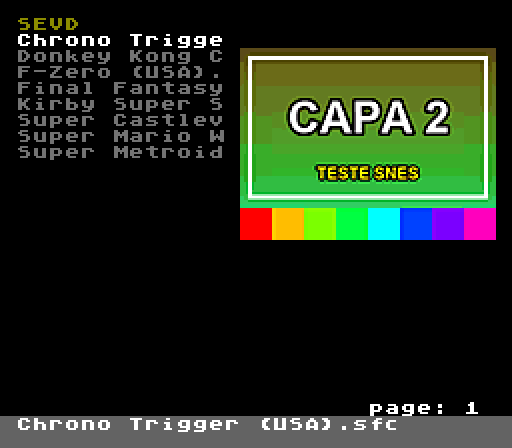
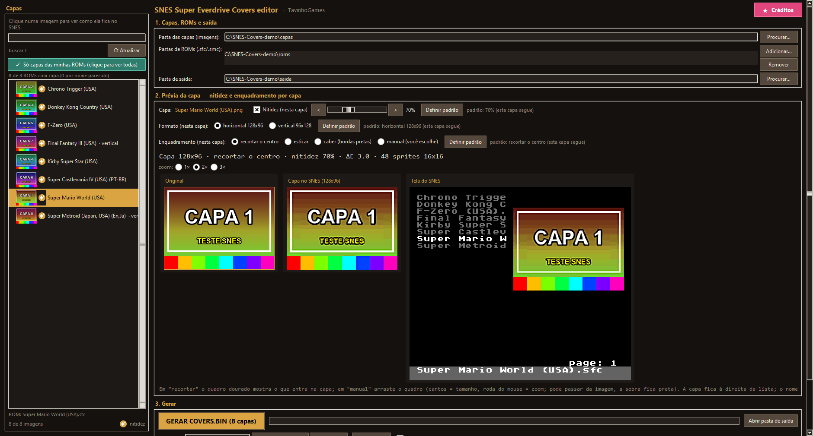
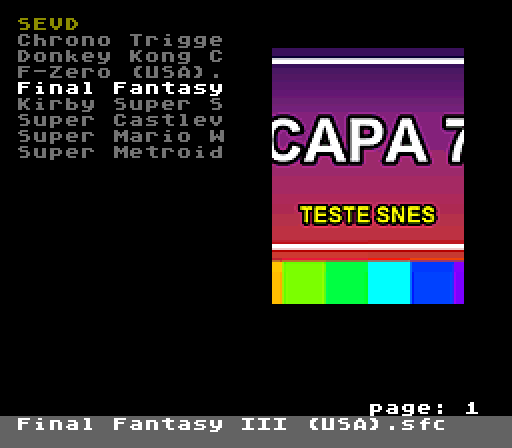
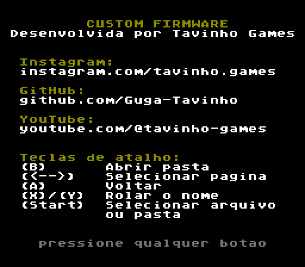

# SNES Super Everdrive Covers editor

**🇧🇷 [Português](README.md) · 🇺🇸 [English](README.en.md) · 🇪🇸 [Español](README.es.md)**

---

## 🇧🇷 Português

Firmware custom para o **Super EverDrive (clone) de SNES** que mostra a **capa de cada jogo** ao lado da lista de
jogos, e uma ferramenta para Windows que converte as suas imagens e gera tudo pronto para o cartão SD.

### O que tem de novo em relação à firmware original

| | Original | Custom |
|---|---|---|
| **Capa do jogo** | — | Capa à direita da lista, com até **120 cores** e sem tremer |
| **Formato da capa** | — | **Horizontal 128×96** ou **vertical 96×128**, escolhido **em cada jogo** |
| **Nome na lista** | `001 Secret of Ma` + tamanho/`DIR` | Só o nome do jogo (13 letras), sem número na frente |
| **Nome completo** | Só rolando com X/Y | **Barra cinza** embaixo com o nome completo (até 60 letras) |
| **Número da página** | Embaixo, à esquerda | No **canto direito** |
| **← →** (trocar página) | Mantém a linha do cursor | Vai para o **primeiro jogo da página** |
| **Tela "about"** | Créditos do fabricante | Créditos da custom + **teclas de atalho** |

| Navegador com capa vertical | Tela "about" |
|---|---|
|  |  |

O resto do console funciona como na firmware original: carregar jogos, saves (SRAM), opções, update de OS etc.

### Requisitos

- **Windows 10 ou 11 (64 bits)** para a ferramenta. Não precisa instalar nada (nem Python).
- Um **Super EverDrive clone de SNES**. A firmware foi feita a partir do **OS v12** desse cartucho.
- As imagens das capas (**PNG, JPG, BMP, GIF ou WEBP**).

### Instalação da ferramenta

1. Baixe o **`SNES Super Everdrive Covers Editor.zip`** na página de *Releases*.
2. **Extraia** o zip numa pasta (não rode o programa de dentro do zip).
3. Abra **`SNES Super Everdrive Covers Editor.exe`**. Deixe a pasta **`_internal`** sempre junto do `.exe`.

> O Windows pode mostrar "O Windows protegeu o computador" (programa novo, sem assinatura digital). Clique em
> **Mais informações → Executar assim mesmo**.

### Como usar

**1. Capas, ROMs e saída**
- **Pasta das capas:** a pasta com as imagens. O nome da imagem deve ser parecido com o nome da ROM
  (ex.: `Super Metroid (Japan, USA).png`). A ferramenta associa sozinha mesmo com pequenas diferenças
  (região, versão, `(Rev 1)`, `[!]`…).
- **Pastas de ROMs:** onde estão as suas ROMs (`.sfc`, `.smc`, `.fig`, `.swc`). Pode ser o próprio cartão SD;
  as subpastas também são lidas.
- **Pasta de saída:** onde os arquivos são gerados.

Na lista à esquerda, **"Mostrar só capas das minhas ROMs"** mostra só as imagens que serão usadas, e
**"Ver ROMs sem capa…"** lista as ROMs que não acharam imagem.

**2. Prévia da capa** — clique numa capa da lista para ver como ela fica no SNES.

| Opção | O que faz |
|---|---|
| **Formato** | Horizontal 128×96 (caixas americanas) ou vertical 96×128 (caixas japonesas/europeias). |
| **Nitidez** (10–200%) | Realça contornos e letras ao reduzir a imagem. |
| **Enquadramento** | **Recortar o centro**, **esticar**, **caber** (com bordas pretas) ou **manual**. |
| **Manual** | Arraste o quadro dourado na imagem original: pelos cantos muda o tamanho, a roda do mouse aproxima/afasta. O quadro pode passar da imagem (a sobra fica preta). |
| **Definir padrão** | Aplica a escolha a todas as capas que não têm ajuste próprio. |
| **Prévias** | Original, a capa como o SNES mostra e a **tela do console** (igual à da TV). |

As escolhas de cada capa ficam salvas no arquivo `capas_config_snes.json`, dentro da pasta das capas.

**3. Gerar**
1. Em **Cartão SD**, clique em **Adicionar caminho…** e escolha a raiz do cartão (ex.: `F:\`).
2. Deixe marcado **"copiar também a firmware para o cartão"** (na primeira vez).
3. Clique em **GERAR COVERS.BIN**. Vai para o cartão:
   - `SEVD\COVERS.BIN` (as capas)
   - `os-capas-v4.smc` (a firmware, na raiz do cartão)

**4. Instalar a firmware no console (só uma vez)**
1. Ligue o console e vá em **toolbox → update os**.
2. Escolha o arquivo **`os-capas-v4.smc`**, aperte **Start** e confirme com **B (YES)**.
3. Espere terminar (step1, step2, step3); o console reinicia sozinho.

Depois disso, para mudar ou acrescentar capas, é só **gerar de novo** — não precisa reinstalar a firmware.

### Teclas no navegador

| Tecla | Ação |
|---|---|
| **B** | Abrir pasta |
| **← →** | Página anterior / próxima (vai para o topo da página) |
| **A** | Voltar |
| **X / Y** | Rolar o nome longo na lista |
| **Start** | Selecionar arquivo / pasta |

### Limitações

- **Até 4.000 capas** por cartão (**3.851** se houver alguma capa vertical).
- **Até 200 itens por pasta** (limite do OS original do cartucho).
- **Sem acentos:** a fonte do console não tem letras acentuadas; elas aparecem como espaço.
- **Ordem da lista:** o OS original ordena só pelas **2 primeiras letras**; jogos com o mesmo começo
  (ex.: vários "Super …") podem ficar fora de ordem entre si.
- Na lista o nome aparece com **13 letras**; na barra, até **60 letras**.
- A capa é encontrada pelo **nome do arquivo da ROM**. Se você renomear uma ROM, gere o `COVERS.BIN` de novo.
  ROMs com o mesmo nome em pastas diferentes usam a mesma capa.
- Feita e testada para o **Super EverDrive clone com OS v12**. Outras versões/modelos não foram testados.

### Segurança

- A firmware é instalada pelo **"update os" original** do próprio console e só grava a área do OS principal.
  O **reserve OS** (sistema de recuperação) **nunca é alterado**.
- **Se algo der errado:** ligue o console **segurando X + A** para entrar no *reserve OS* e reinstale a
  firmware original (`os-v12.smc`) por **toolbox → update os**.
- Guarde uma cópia da firmware original do seu cartucho.

### Créditos

- Custom firmware e ferramenta: **Tavinho Games** —
  [Instagram](https://www.instagram.com/tavinho.games) ·
  [GitHub](https://github.com/Guga-Tavinho) ·
  [YouTube](https://www.youtube.com/@tavinho-games)

---

